# 00. Preparation

!!! abstract "Objective"
    Access the dCloud environment, start the CML lab, and open the router consoles.

## Lab access

Use the dCloud access details provided for your session, or visit [dcloud.cisco.com](https://dcloud.cisco.com/) and open **My Hub**. Select **SYD ANZ Datacenter**.

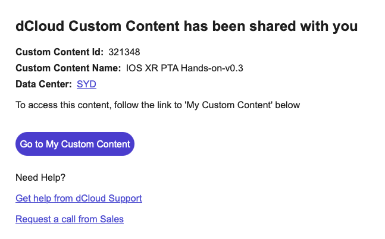

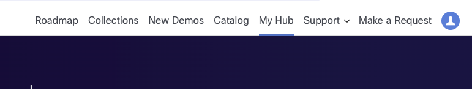

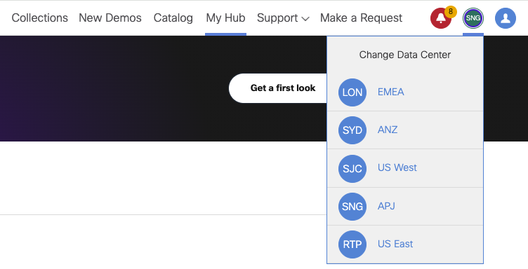

## Open the lab session

1. Select **Sessions**, then select **View** for your session.

    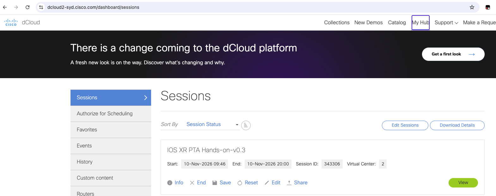

2. In the session view, open the Ubuntu VM.

    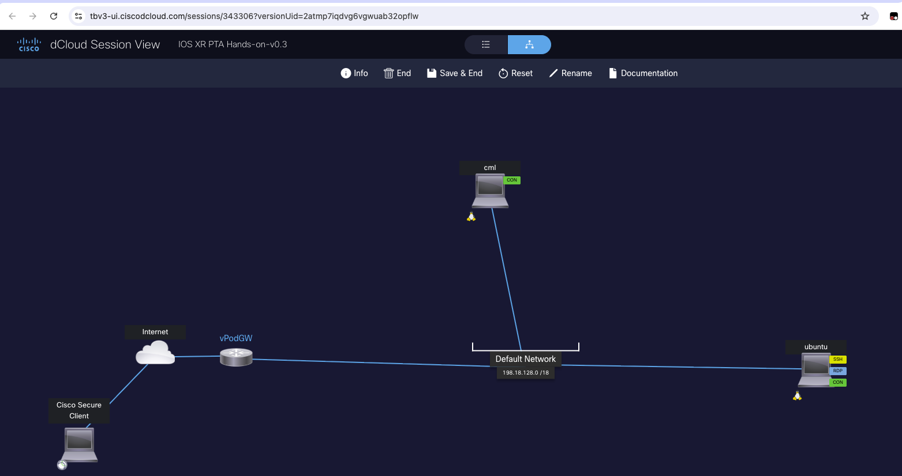

3. In the Ubuntu VM, open **Remote Access** and select **VM Console**. Launch the Chromium browser, then open the **Login::CML2** link and sign in with the credentials supplied for the lab.

    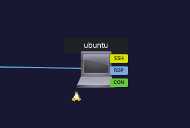

    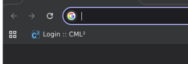

4. Open Cisco Modeling Labs and start the lab.

    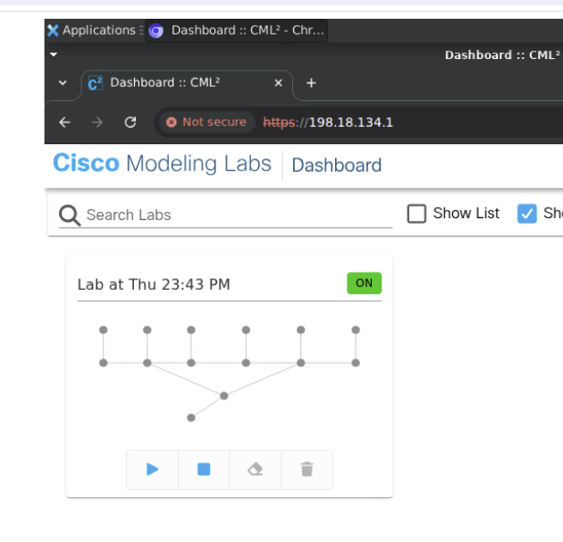

    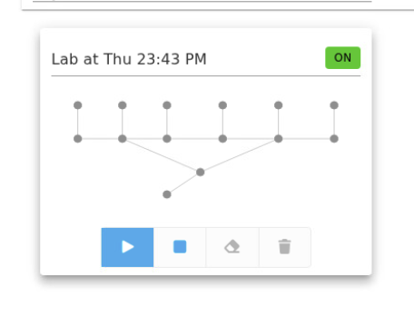

    Wait about five minutes for the devices to boot, then open the topology.

    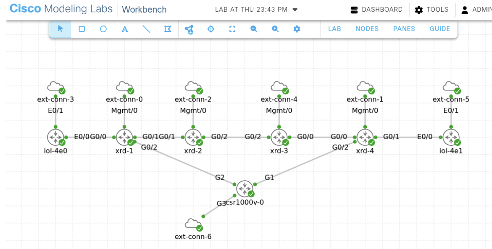

## Open a router console

Right-click a device and select **Console**. Use the device credentials supplied for the lab. If a virtual router becomes unresponsive during an exercise, stop and restart that device in CML.

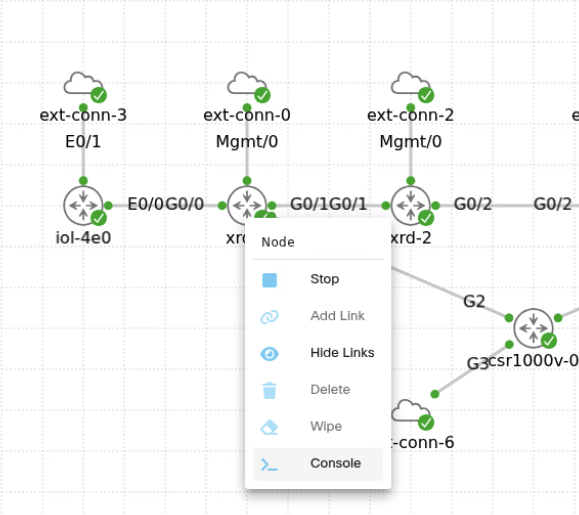

When the console is ready, begin the exercises in [01. Commit configuration](../01-commit-configuration/index.md).

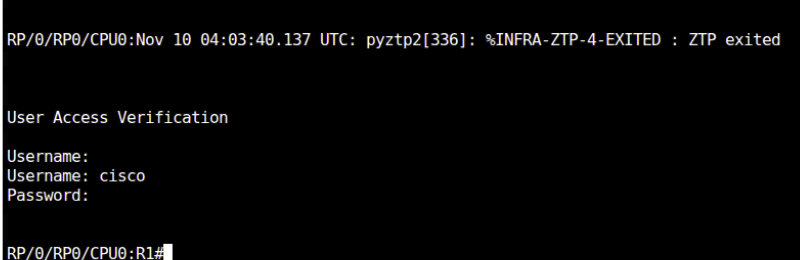