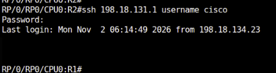
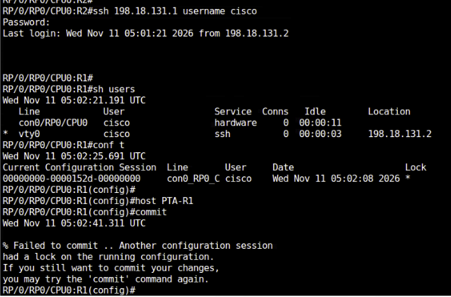

# 01. Commit configuration

!!! abstract "Goal"
    Stage changes in IOS XR target configuration, commit them with labels, and practise best-effort commit, confirmed commit, exclusive configuration sessions, and rollback.

## 1.1 Commit

In Cisco IOS XR, **target configuration** is the set of configuration changes you enter in configuration mode before applying them to the router's active (running) configuration. Once committed, the changes take effect in the running configuration.

### Exercise 1.1

Change the hostname of R1 and commit it.

```text
RP/0/RP0/CPU0:R1(config)#host PE-1
RP/0/RP0/CPU0:R1(config)#show
!! Building configuration...
!! IOS XR Configuration 26.1.1
hostname PE-1
end
RP/0/RP0/CPU0:R1(config)#show config
!! Building configuration...
!! IOS XR Configuration 26.1.1
hostname PE-1
end
RP/0/RP0/CPU0:R1(config)#commit
RP/0/RP0/CPU0:PE-1(config)#
```

Use `show` or `show config` to inspect the target configuration before committing it.

## 1.2 Commit with label

Associate a descriptive label with a commit to help identify the changes later.

### Exercise 1.2

Configure a loopback interface, verify the target configuration, and commit it with a label.

1. Enter configuration mode and configure a loopback interface.
2. Use `show` to view the target configuration.
3. Use `commit label ADDEDLOOPBACK0` to move it to running configuration.
4. Verify the running configuration.

```text
RP/0/RP0/CPU0:R1(config)#int lo11
RP/0/RP0/CPU0:R1(config-if)#ip address 11.11.11.11/32
RP/0/RP0/CPU0:R1(config-if)#exit
```

```text
RP/0/RP0/CPU0:R1(config)#show
Wed Oct 28 05:53:23.345 UTC
!! Building configuration...
!! IOS XR Configuration 26.1.1
interface Loopback11
 ipv4 address 11.11.11.11 255.255.255.255
!
end
RP/0/RP0/CPU0:R1(config)#
```

Verify the running configuration:

```text
RP/0/RP0/CPU0:R1(config)#commit label ?
  WORD  Label for this commit (must begin with an alphabet)
RP/0/RP0/CPU0:R1(config)#commit label ADDEDLOOPBACK0
Wed Oct 28 05:55:31.421 UTC
RP/0/RP0/CPU0:R1(config)#end
RP/0/RP0/CPU0:R1#sh running-config interface lo11
Wed Oct 28 05:57:47.885 UTC
interface Loopback11
 ipv4 address 11.11.11.11 255.255.255.255
!
RP/0/RP0/CPU0:R1#
```

## 1.3 Commit best-effort

The `commit best-effort` operation merges the target configuration with the running configuration and commits only the valid changes.

Unlike an atomic commit, where the entire configuration is rolled back if any error occurs, a best-effort commit allows valid configuration items to be applied even if some items fail due to semantic errors.

### Exercise 1.3

Enter the following class maps and policy map, then commit.

```text
class-map DATA_1
 match dscp AF11
 exit

 class-map DATA_2
  match dscp AF21
  exit

policy-map CBWFQ
 class DATA_1
  bandwidth percent 10

 class DATA_3
  bandwidth percent 20
commit
```

1. Observe that the commit does not succeed, and note the error.
2. Use `show` or `show config` in global configuration mode to view the target config.
3. Use `show configuration failed` to understand why the commit did not succeed.
4. Use `commit best-effort` to commit only the valid configs.
5. Use `show run class-map DATA_1` and `show run class-map DATA_2` to check the valid configs pushed to the device.

!!! warning "TODO"
  The source does not include the failed commit output.

## 1.4 Commit confirmed

In Cisco IOS XR, the `commit confirmed` command applies target configuration changes to the running configuration on a temporary basis, automatically rolling them back if they are not confirmed within a specified timeframe. This mechanism acts as a critical safety net against accidental lockouts, particularly when altering remote management or AAA configurations.

The default timer to roll back to the previous config is **10 minutes**. You can also give an explicit timer; if a second `commit` is not issued, the configuration rolls back.

### Exercise 1.4

Configure a loopback interface and use `commit confirmed` to commit the configs.

```text
int lo10
ip address 10.10.10.10/32

commit confirmed 60
```

| Parameter | Value | Notes |
| --- | --- | --- |
| Interface | `lo10` | Loopback used in this exercise |
| Address | `10.10.10.10/32` | Configured on the loopback |
| Confirmed timer | `60` | Seconds before automatic rollback if a second `commit` is not issued |

Wait 60 seconds without issuing a second `commit`; the loopback configuration will roll back. Verify it with `show run interface lo10` or `show configuration rollback changes last 1`.

To keep the changes instead, issue a second `commit` within 60 seconds.

## 1.5 Configure exclusive

In Cisco IOS XR, an exclusive configuration session allows a user to lock out all other users from committing configuration changes until the session is ended. While other users can still create or modify their own target configurations, they cannot commit those changes to the running configuration while an exclusive session is active.

### Exercise 1.5

1. Log in to R1 with username `cisco` and password `<password>`.
2. Establish an exclusive configuration session with `configure exclusive`.
3. From the R2 console, connect to R1 using SSH and the `cisco` account.

    

4. In the SSH session, try to configure and commit a change. Observe the lock error.

    

## 1.6 Rollback

In Cisco IOS XR, configuration rollback allows you to revert the router's running configuration to a previously committed configuration without manually restoring each command.

IOS XR maintains a history of committed configurations, which you can use to roll back changes. You can roll back using the label or up to a certain commit.

### Exercise 1.6

1. Use `rollback configuration last 1` to roll back to the previous commit.

Other useful CLIs for day-to-day operations:

- `show configuration commit changes last <Number of commits>` — view the configurations committed since the last number of commits.
- `show configuration commit list` — see all the previous committed config.
- `show cli history detail` — view all the CLI executed.
- `show context` and `show exceptions` — view crash information.

!!! warning "TODO"
  The source does not include sample output for rollback or these operational show commands.

## Next step

Continue with [02. IOS XR operations and monitoring tools](../02-operations-and-monitoring/index.md).
