# 02. IOS XR operations and monitoring tools

!!! abstract "Goal"
    Inspect IOS XR processes, CPU and memory, filter show-command output, use `describe` and traces, collect tech-support files, and practise task-group authorization.

## 2.1 Process management

- **Process** — an executable portion of code run within its own memory space.
- **Threads** — a process may contain one or more threads (a sub-process). For example, the ISIS process has a thread which handles hellos. A thread may only run when the parent process is allocated runtime by the system scheduler.
- **Job ID (JID) and Process ID (PID)** — each process is allocated a Job ID (JID) when it is first run. The JID remains associated with the process even if the process is stopped and restarted. The PID changes if the process is stopped and restarted.
- **Thread ID (TID)** — if a process contains threads, each is assigned a TID associated with the PID/JID.

### Exercise 2.1

1. Display the ISIS process:

    ```text
    RP/0/RP0/CPU0:R1#show processes isis
    Thu Oct 29 00:43:33.528 UTC
                      Job Id: 1003
                         PID: 16870
                Process name: isis
    ```

2. Note the job ID, process ID, and thread ID.
3. Restart the ISIS process with `process restart isis`.
4. Observe the job ID, process ID, and thread ID again. The job ID will not change, but the process ID and thread ID will change.

| Parameter | Value | Notes |
| --- | --- | --- |
| Process | `isis` | Process inspected in this exercise |
| Job Id | `1003` | Remains associated with the process across restart |
| PID | `16870` | Changes if the process is stopped and restarted |

!!! warning "TODO"
    Draft 0.4 does not include a post-restart `show processes isis` capture.

## 2.2 Monitor process

The `monitor process` command provides Unix `top`-like information. It displays details on the number of running processes, CPU, and memory utilization, and automatically updates every 10 seconds.

### Exercise 2.2

1. Issue `monitor process` and observe which process consumes more CPU.
2. To change the parameters displayed, enter one of the interactive commands (for example `?` for help).
3. Use `n` for the number of entries to display.

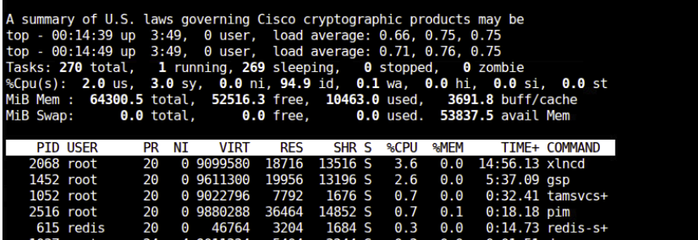

To check whether a process is blocked, run `show process blocked location <location>` several times and compare the results.

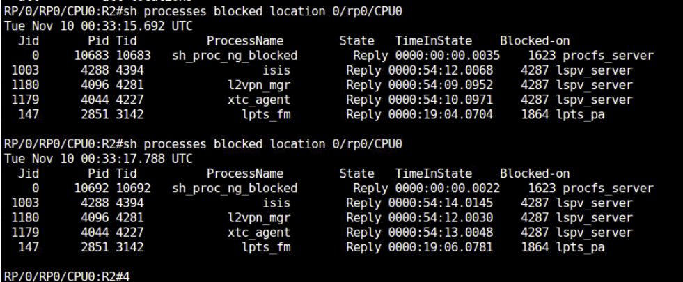

## 2.3 Memory leak detection

In Cisco IOS XR, a memory leak occurs when a process allocates memory for its own use but fails to return that memory to the free pool once it is no longer needed. This results in a situation where free memory appears to be "leaking" away.

There is a built-in tool in XR which computes automatically which process has allocated some memory between two snapshots. The objective is to find out if a process is leaking memory: requesting memory but never releasing it when it does not need it anymore.

If you feel some trigger is leaking the memory, you can detect a memory leak with the following method.

### Exercise 3.1

1. Take a baseline snapshot:

    ```text
    show memory compare start
    ```

2. Execute the trigger. It can be restarting the ISIS process or relearning the BGP routes.
3. Take the second snapshot:

    ```text
    show memory compare end
    ```

4. Generate the report:

    ```text
    show memory compare report
    ```

`show memory compare report` shows differences between the baseline snapshot and the second snapshot.

!!! warning "TODO"
    The source does not include sample command output.

Other useful memory commands:

```text
show memory summary
show memory summary detail location all
```

## 2.4 Multipipe support

IOS XR supports multiple pipes on the command line so that the output can be processed by an enhanced utility set to filter and format the output of any show command. Up to 8 pipes are supported.

### Exercise 2.4

1. Use multiple pipes to extract required information from the show commands.

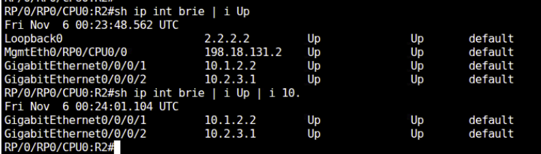

## 2.5 Describe command

In Cisco IOS XR, the `describe` command is a powerful operational utility used to inspect the internal details, required privileges, and background architecture of any CLI command.

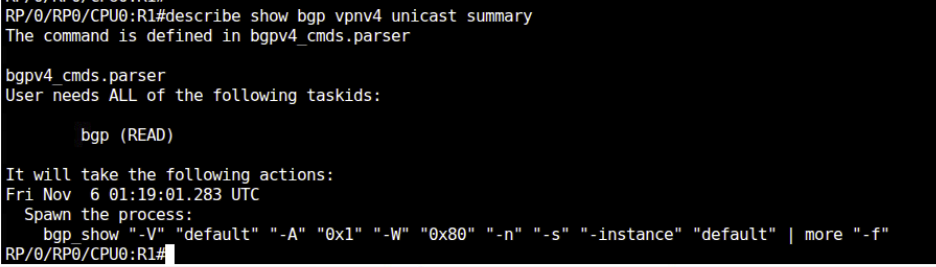

### Exercise 2.5

1. Execute `show bgp vpn4 unicast summary` or your favourite command.
2. Append `describe` to the command and execute it again.
3. Observe the privileges required to execute this command.
4. Note down the CLI under **Spawn the Process**.
5. Execute `run` to enter into the root Linux kernel.
6. Execute the CLI which you got under spawn the process and observe the output.

!!! warning "TODO"
    The source does not include output from the `run` / spawned process step.

## 2.6 Trace functionality

Trace functionality in Cisco IOS XR serves as an always-on diagnostic logging mechanism. It acts like persistent debug logs for specific daemons, protocols, and hardware components without requiring you to turn on heavy, disruptive real-time debugs.

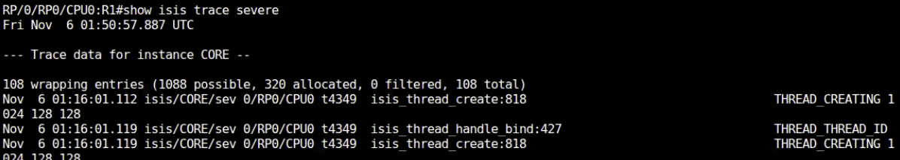

1. Run `show isis trace` or `show bgp trace` and check the debug logs.
2. Add the keyword `tailf` to view the latest debug.

## 2.7 show tech-support functionality

In Cisco IOS XR, the foundational command to collect systemic diagnostic information is `show tech-support`. Unlike classic Cisco IOS, which streams all output directly to the terminal line-by-line, IOS XR is built to optimize this highly intensive operation by generating bundled, compressed log files onto the router's disk for straightforward extraction.

You can also collect `show tech-support` for a specific module.

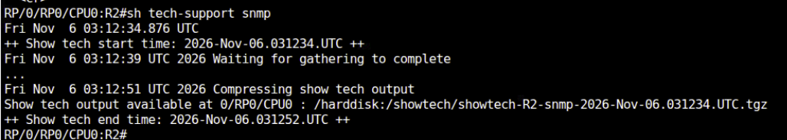

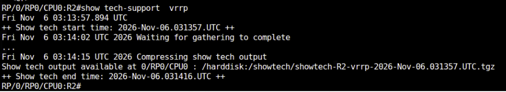

## 2.8 Task groups

IOS XR has a strong embedded mechanism for user authentication and authorization. XR does not have the concept of privilege levels as IOS had. Embedded user task group management allows creation of different task groups. You can use a system-defined group, or you can define your own task group and assign granular privileges.

### Exercise 2.8.1

1. Create a user called `lab` and bind the usergroup `level_1`.
2. Log in as `lab` and check what privileges the user has.

```text
username lab
 group operator
 secret <password>
```

| Parameter | Value | Notes |
| --- | --- | --- |
| Username | `lab` | Consistent in the exercise and config sample |
| User group | `level_1` / `operator` | Exercise asks for `level_1`; config sample uses `operator` |
| Secret | `<password>` | Do not store a real secret in this guide |

!!! warning "TODO"
    Confirm whether Exercise 2.8.1 should use the custom `level_1` group or the system-defined `operator` group. The source does not include login or privilege-check output.

### Exercise 2.8.2

1. Define a taskgroup called `ISISREAD` and give only read permission for ISIS.
2. Define a usergroup called `LEVEL_1` and bind the taskgroup `ISISREAD`.
3. Create a user called `lab` and bind the usergroup `level_1`.
4. Log in as `lab` and check what privileges the user has.

```text
taskgroup ISISREAD
 task read isis

usergroup LEVEL_1
 taskgroup ISISREAD

username lab
 group LEVEL_1
 secret <password>
```

| Parameter | Value | Notes |
| --- | --- | --- |
| Task group | `ISISREAD` | `task read isis` only |
| User group | `LEVEL_1` | Bound to `ISISREAD` |
| Username | `lab` | Bound to `LEVEL_1` |
| Secret | `<password>` | Placeholder |

Use these commands to inspect authentication and group privileges:

```text
show user authentication method
show aaa usergroup operator
show aaa usergroup level_1
```

- `show user authentication method` — see by which method you are authenticated.
- `show aaa usergroup operator` — check what privileges the system-defined usergroup has.
- `show aaa usergroup level_1` — check what privileges the custom-defined usergroup has.

!!! note
    `cisco-support` has the highest privilege.

!!! warning "TODO"
    The original notes do not include output for the `show user` / `show aaa usergroup` commands.

## 2.9 Run and attach

The `run` command opens the underlying Linux Bash shell from IOS XR EXEC mode. Use `exit` to return to the IOS XR CLI.

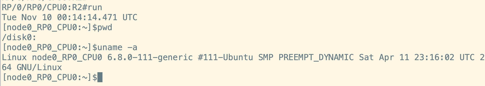

On a multi-line-card chassis, use `attach` from admin mode to access a line card. This command is not available in the virtual XRd lab; the screenshot is provided for reference.

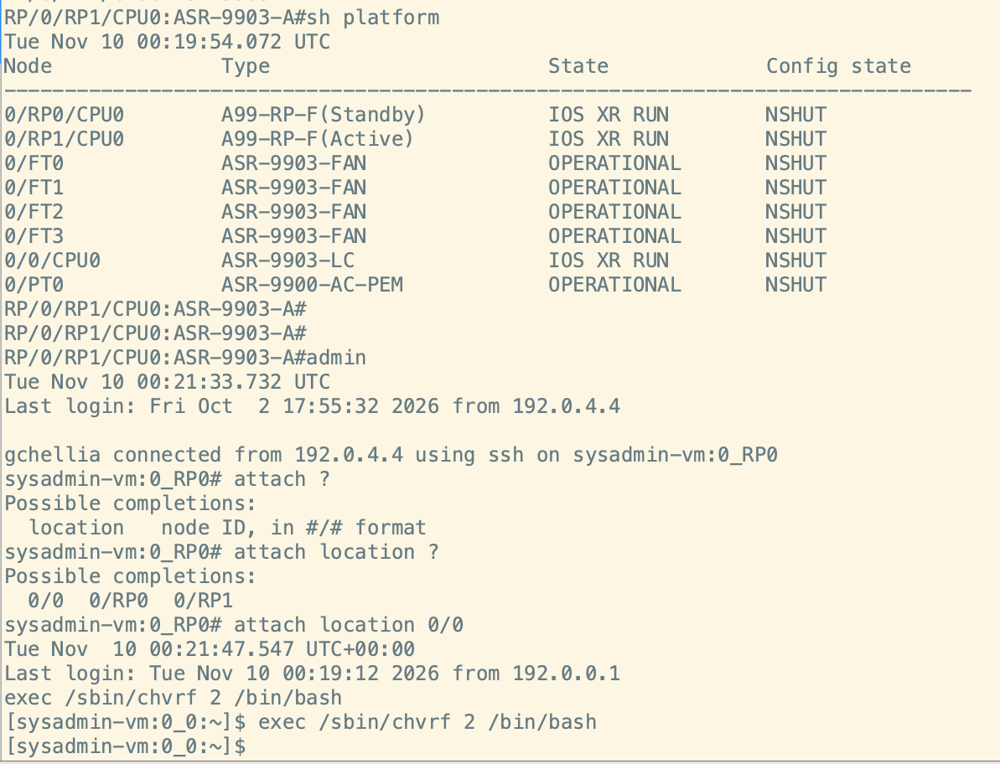

## 2.10 Interface troubleshooting

Use `show controllers <interface-name> all` to inspect low-level hardware and interface-controller diagnostics.

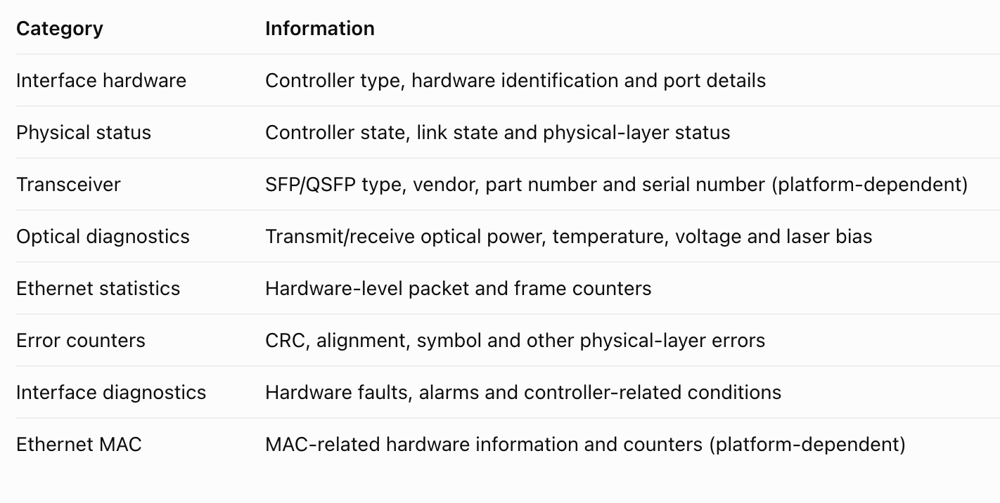

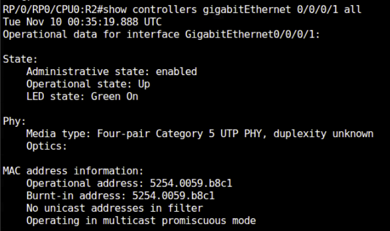

The following output is from physical 8202 hardware.

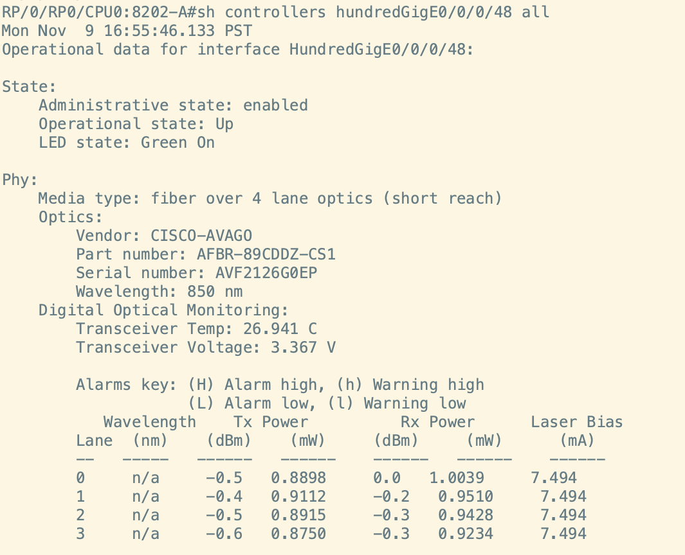

## Next step

Continue with [03. ISIS and segment routing](../03-bgp-and-isis/index.md).
