# 03. ISIS and segment routing

!!! abstract "Goal"
    Inspect the ISIS core and segment-routing labels, then troubleshoot reachability across a failed link.

## Topology and lab state

The lab topology and management addresses are shown below.

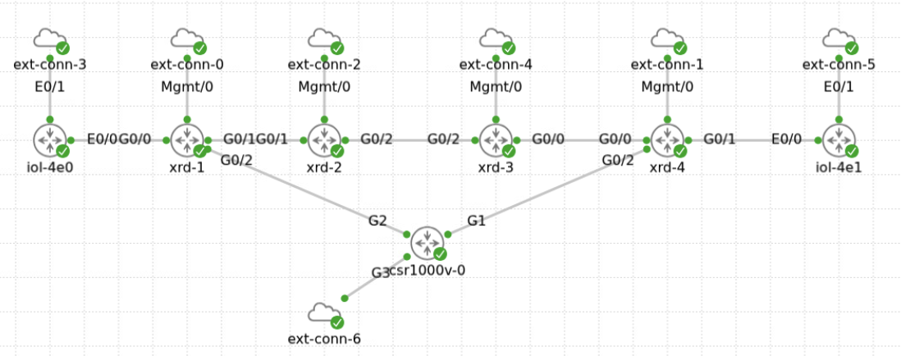

| No. | Router | Hostname | Role | Management IP |
| --- | --- | --- | --- | --- |
| 1 | `xrd-1` | `R1` | PE-1 | `198.18.131.1` |
| 2 | `xrd-2` | `R2` | Provider | `198.18.131.2` |
| 3 | `xrd-3` | `R3` | Provider | `198.18.131.3` |
| 4 | `xrd-4` | `R4` | PE-2 | `198.18.131.4` |
| 5 | `Iol-4e0` | `CE-1` | Customer edge | `198.18.131.5` |
| 6 | `Iol-4e1` | `CE-2` | Customer edge | `198.18.131.6` |
| 7 | `Csr-1000v` | `RR-R7` | Route reflector | `198.18.131.7` |

!!! note
    The lab starts with an L3VPN and ISIS core already configured. PE-CE routing initially uses OSPF; later chapters introduce BGP. Segment routing is preconfigured for the initial exercises, with no LDP.

## 3.1 Inspect ISIS

Review the ISIS configuration and state on each router. Identify the process name, neighboring system IDs, adjacency interfaces, ISIS level, database contents, and prefix-SID index.

```text
show running-config router isis CORE
show isis interface
show isis neighbor
show isis database
```

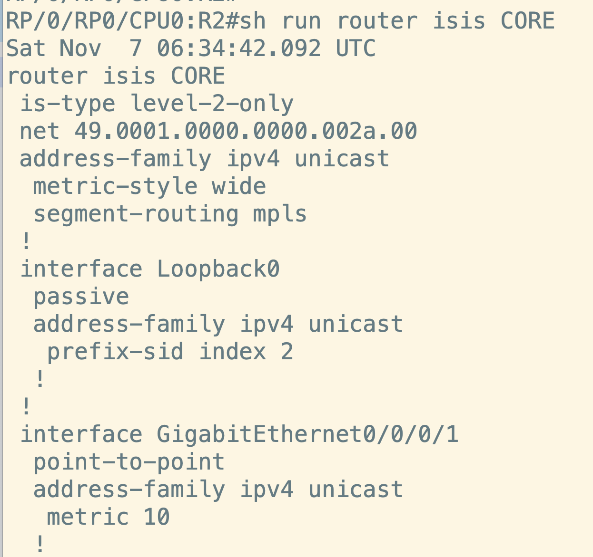

## 3.2 Inspect segment routing

Segment routing is preconfigured. Identify the prefix-SIDs, check that they are advertised in the ISIS database, and verify the corresponding MPLS labels.

```text
show running-config router isis CORE
show isis segment-routing label
```

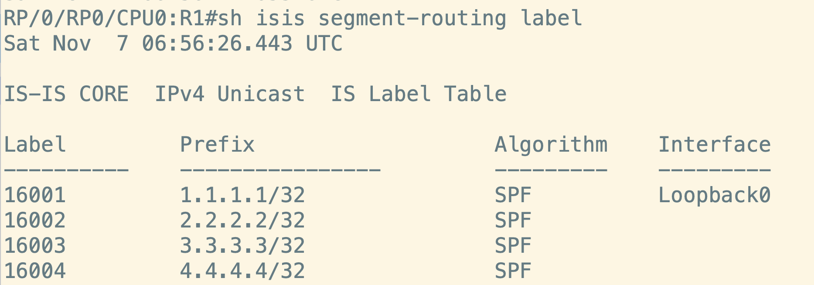

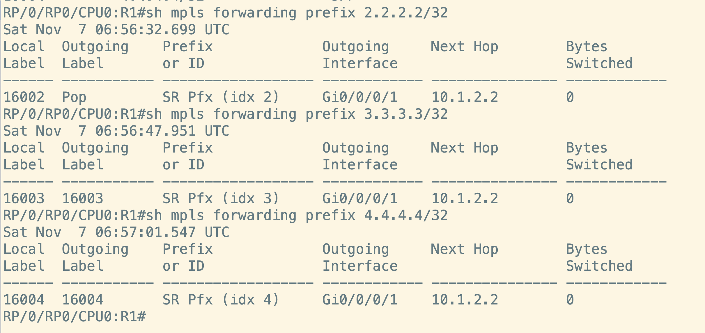

## 3.3 Trace a VPN route and its labels

The prefix `200.1.1.1/32` is advertised by CE-2. Follow it from PE-2 to PE-1 and inspect the VPN and transport labels used across the core.

1. On PE-2, inspect the route and allocated VPN label:

    ```text
    show bgp vpnv4 unicast vrf VPN_A 200.1.1.1/32
    ```

    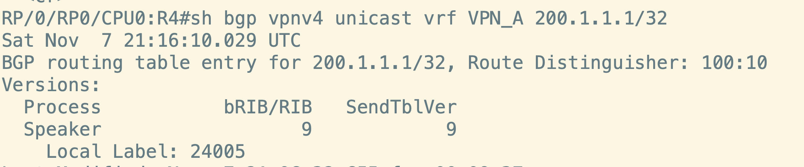

    The source capture shows VPN label `24005`.

2. On PE-1, inspect the received route and label:

    ```text
    show bgp vpnv4 unicast vrf VPN_A 200.1.1.1/32
    ```

    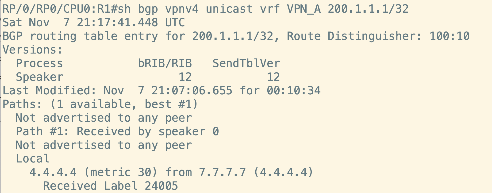

3. Check the segment-routing label to PE-2 and the imposed forwarding labels:

    ```text
    show isis segment-routing label
    ```

    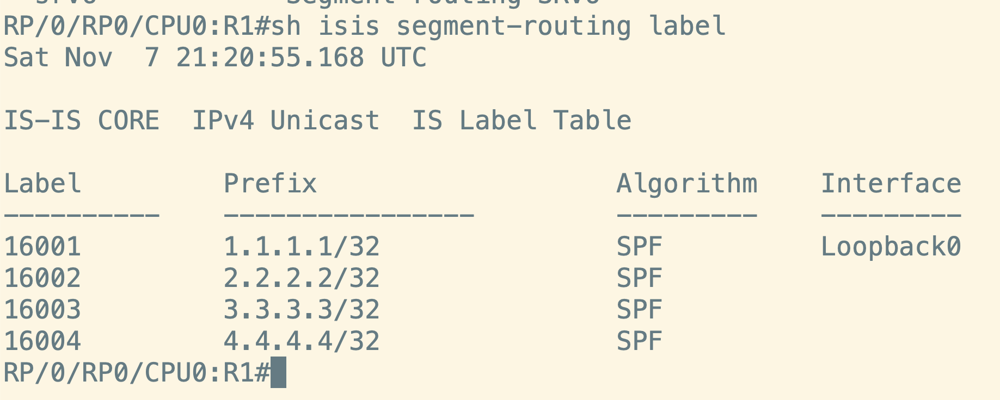

    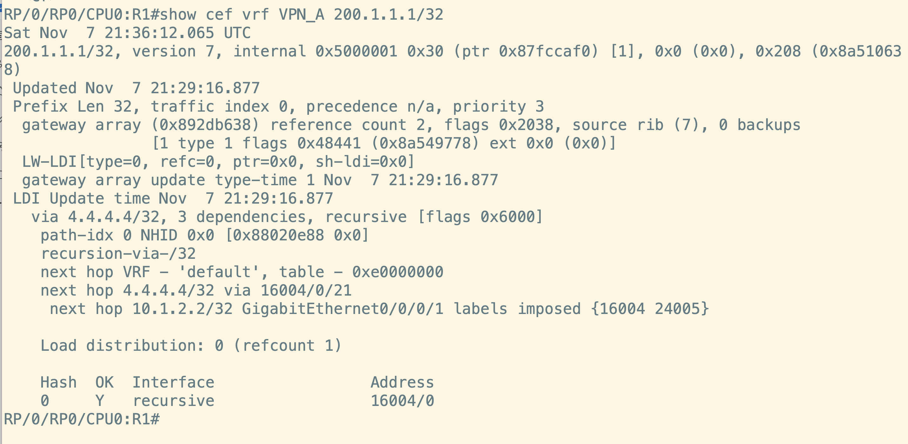

    In the captured example, PE-1 imposes transport label `16004` and VPN label `24005`. Labels can differ if the lab allocates different values.

4. Ping `200.1.1.1` from CE-1 and capture packets on the R1-R2 link. Identify the top (transport) and bottom (VPN) labels.

    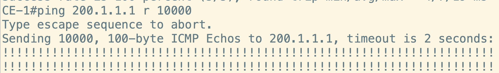

    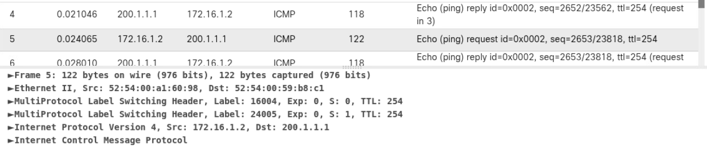

Without traffic engineering, PE-1 uses the endpoint node label rather than stacking every node label along the path.

## 3.4 Troubleshoot a link failure

1. From CE-1, check the route to `200.1.1.1` and ping the destination.

    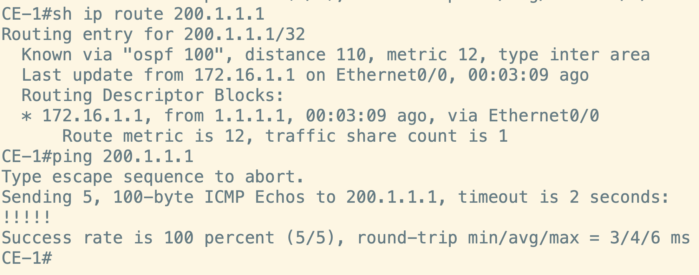

2. Introduce a link failure between R1 and R2.

    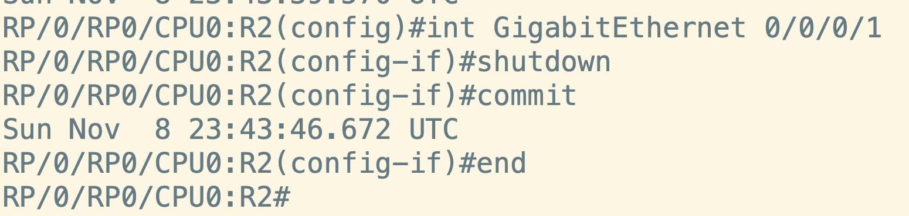

3. Check the route and ping again. The supplied capture shows the ping failing.

    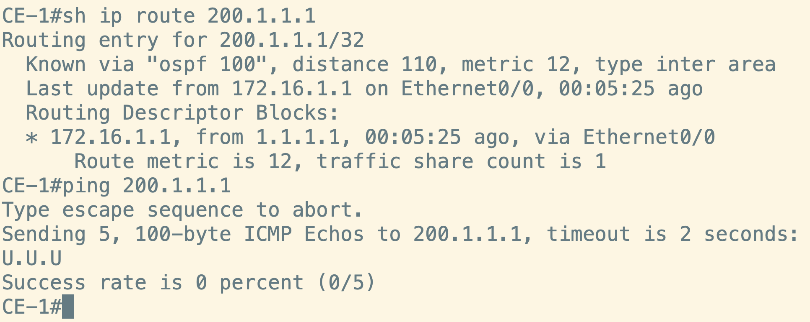

4. Inspect the BGP VPNv4 table on PE-1 and test reachability from PE-1.

    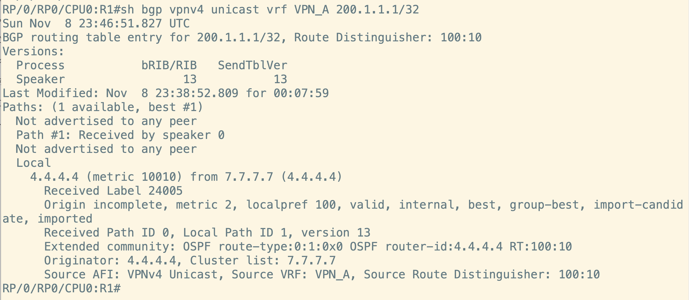

    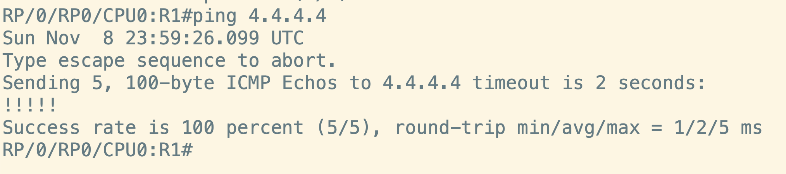

    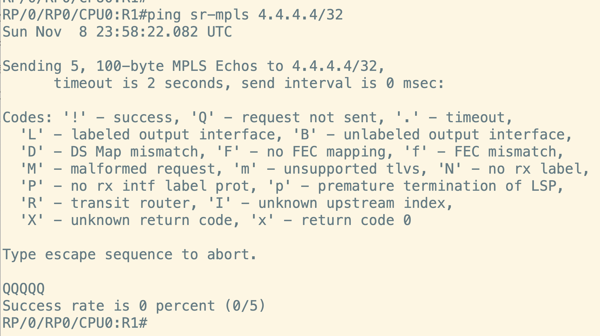

    The regular ping succeeds while the SR-MPLS ping fails, pointing to a segment-routing issue.

5. Check the segment-routing labels along the path from PE-1 to PE-2.

    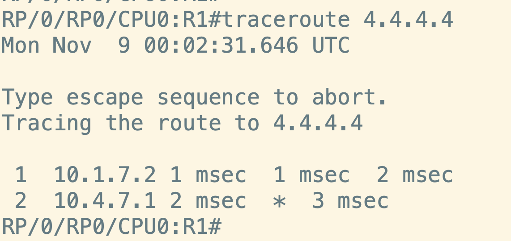

    

    The source exercise identifies missing segment-routing configuration along the path. Add the node SID on the required transit router using the lab's intended prefix and index. The supplied example is:

    ```text
    segment-routing mpls
    connected-prefix-sid-map
     address-family ipv4
      7.7.7.7/32 index 5 range 1
     exit-address-family

    router isis CORE
     segment-routing mpls
    ```

6. Verify the allocated node SIDs, repeat the SR-MPLS ping between PE-1 and PE-2, then check CE-1 to CE-2 connectivity.

    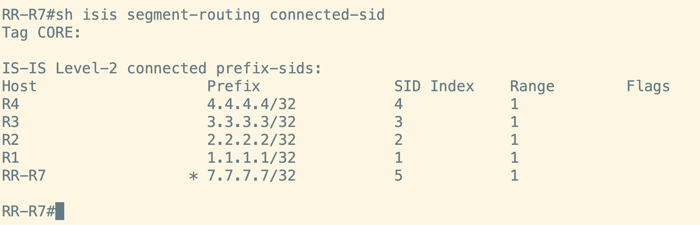

    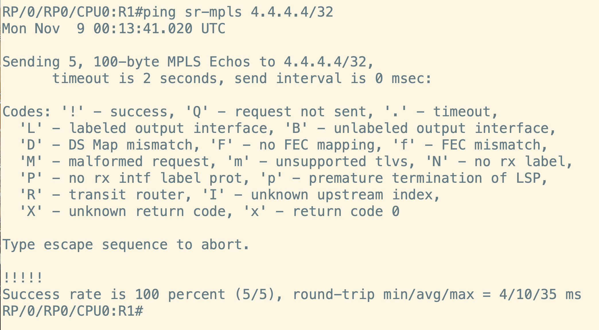

    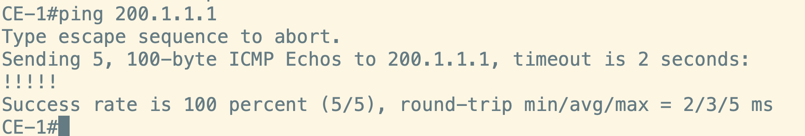

## 3.5 ISIS troubleshooting commands

Run `show isis all` to inspect the ISIS components on an IOS XR router.

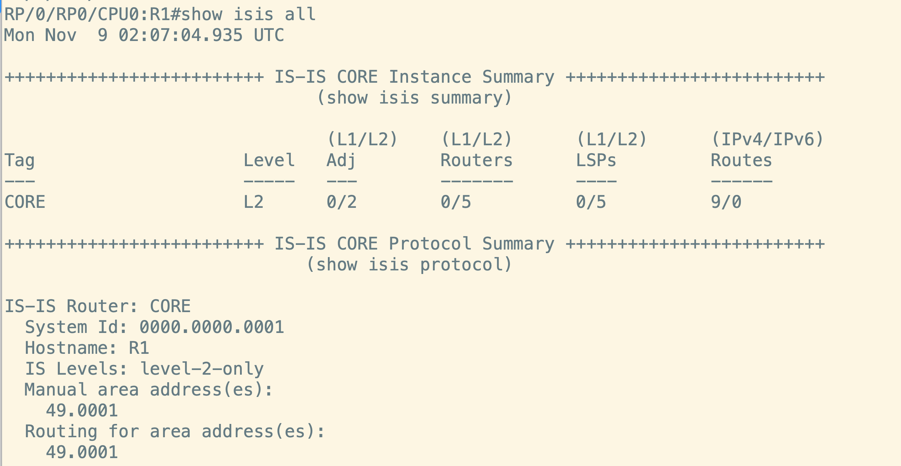

Other useful commands:

```text
show isis trace only hello
show isis adjacency-log
show isis database
```

## Next step

Continue with [04. BGP](../04-bgp/index.md).
