# 04. BGP

!!! abstract "Objective"
    Establish PE-CE eBGP sessions, apply IOS XR routing policies, and control which prefixes are accepted.

## 4.1 Establish PE-CE eBGP

Configure eBGP between PE-1 and CE-1, then between PE-2 and CE-2. Use AS `65101` for CE-1 and AS `65102` for CE-2. Advertise `50.1.1.1/32` from CE-1 and `51.1.1.1/32` from CE-2.

PE-1 neighbor configuration:

```text
router bgp 100
 vrf VPN_A
  neighbor 172.16.1.2
   remote-as 65101
   address-family ipv4 unicast
```

CE-1 loopback and BGP configuration:

```text
interface Loopback50
 ipv4 address 50.1.1.1 255.255.255.255

router bgp 65101
 bgp log-neighbor-changes
 neighbor 172.16.1.1 remote-as 100
 network 50.1.1.1 mask 255.255.255.255
```

Check the session on PE-1:

```text
show bgp vrf VPN_A summary
```

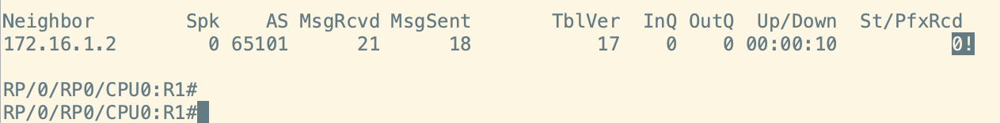

If the session is established but no prefixes are received, IOS XR may be rejecting routes because no route policy is attached. IOS XR requires an inbound and/or outbound routing policy for eBGP routes.

## 4.2 Attach a route policy

Create a pass-through policy and apply it in both directions on the PE-1 neighbor:

```text
route-policy PASS
 pass
end-policy

router bgp 100
 vrf VPN_A
  neighbor 172.16.1.2
   remote-as 65101
   address-family ipv4 unicast
    route-policy PASS in
    route-policy PASS out
```

Verify the session and received routes again.

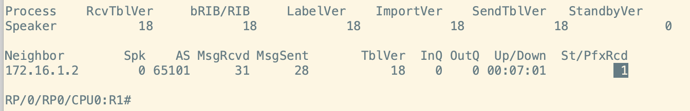

Repeat the PE-CE configuration for PE-2 and CE-2, advertise the CE-2 loopback, and verify connectivity between CE-1 and CE-2.

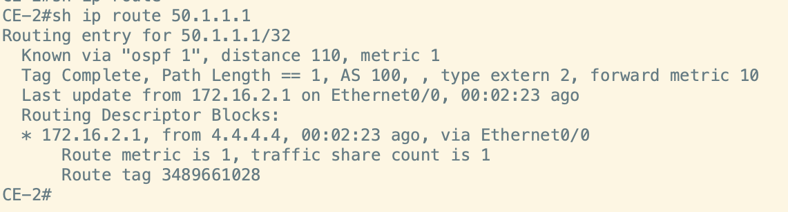

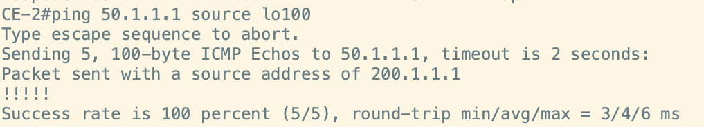

## 4.3 Filter a prefix with RPL

Create five loopbacks on CE-1 and advertise their networks into BGP:

```text
interface Loopback61
 ipv4 address 60.1.1.1 255.255.255.0
interface Loopback62
 ipv4 address 60.1.2.1 255.255.255.0
interface Loopback63
 ipv4 address 60.1.3.1 255.255.255.0
interface Loopback64
 ipv4 address 60.1.4.1 255.255.255.0
interface Loopback65
 ipv4 address 60.1.5.1 255.255.255.0

router bgp 65101
 network 60.1.1.0 mask 255.255.255.0
 network 60.1.2.0 mask 255.255.255.0
 network 60.1.3.0 mask 255.255.255.0
 network 60.1.4.0 mask 255.255.255.0
 network 60.1.5.0 mask 255.255.255.0
```

Verify that all five prefixes appear in the PE-1 BGP VPNv4 table.

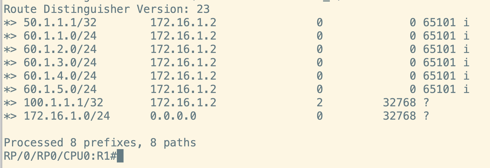

Write an RPL that filters `60.1.3.0/24` and passes the other prefixes. Attach it inbound to neighbor `172.16.1.2`.

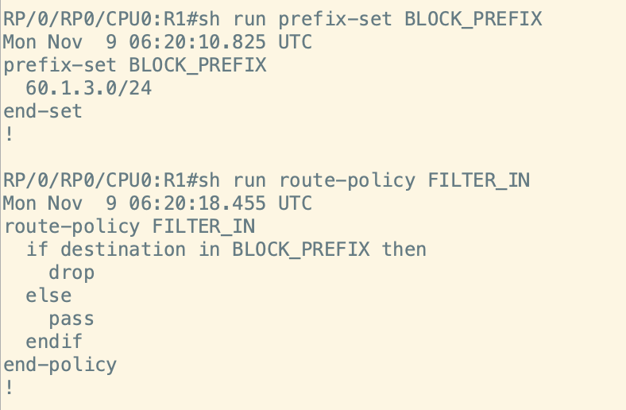

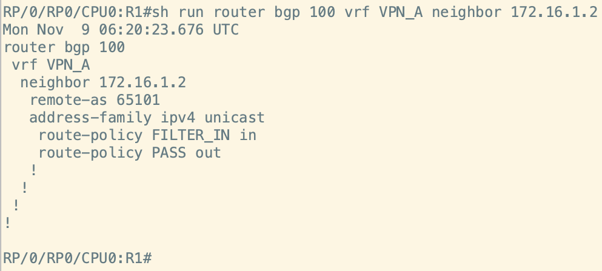

After updating the policy, refresh the inbound BGP table and verify that `60.1.3.0/24` is absent:

```text
clear bgp vpnv4 unicast * soft in
```

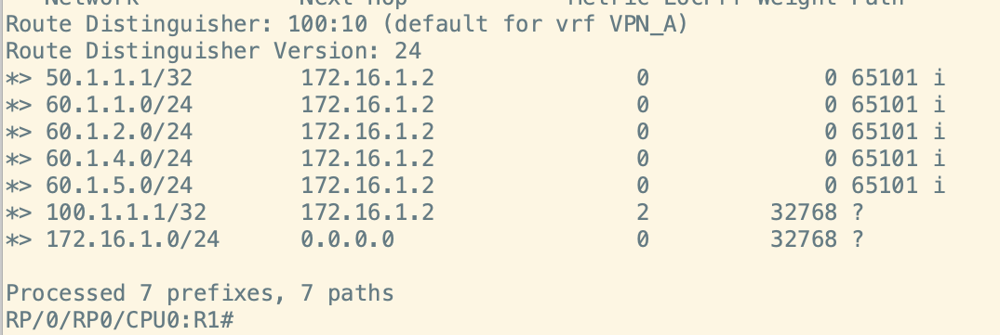

## 4.4 Edit a route policy

The lab screenshots demonstrate editing a route policy in a text editor, validating the syntax, and committing the result. Create a prefix set named `BLOCK_PREFIX_5` and reference it from the `FILTER_IN_5` policy.

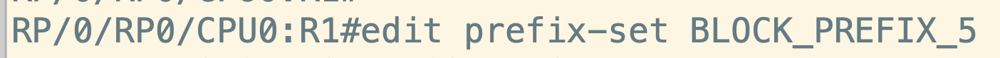

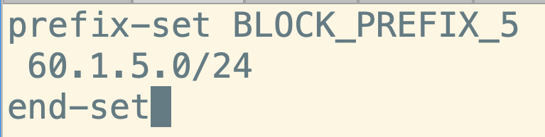

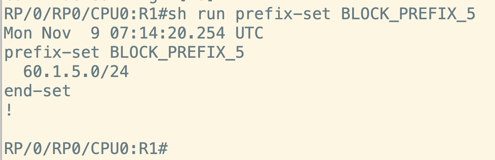


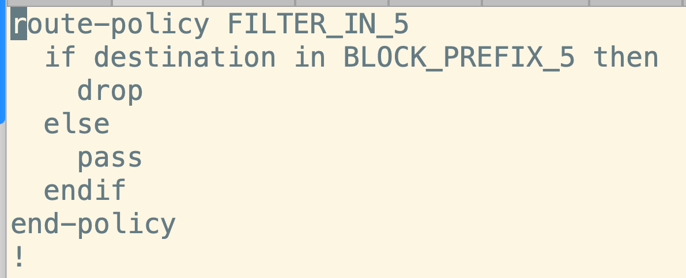

The CLI validates the syntax and allows the configuration to be committed when it is correct.

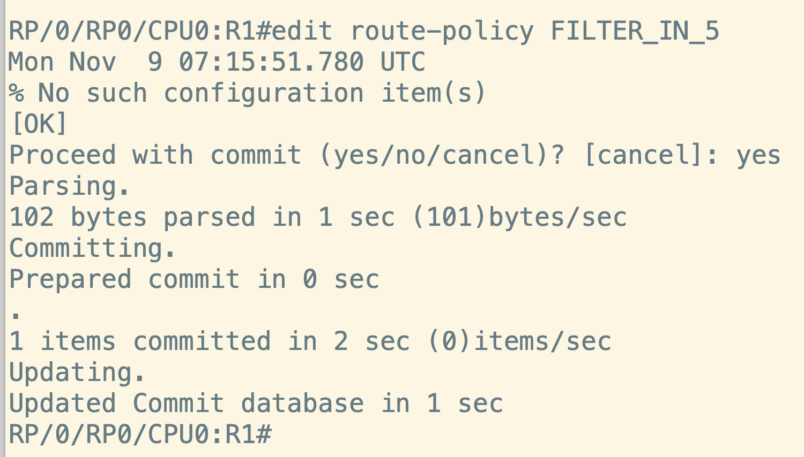

## Finished

Return to the [home page](../index.md) or revisit any chapter from the navigation.